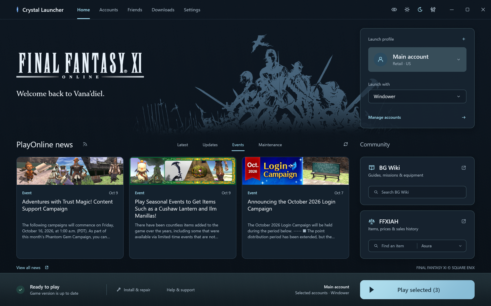
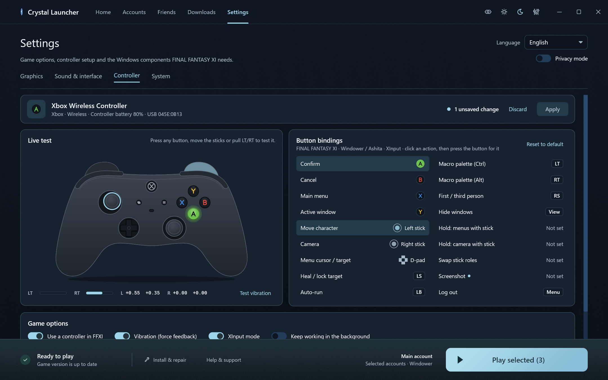
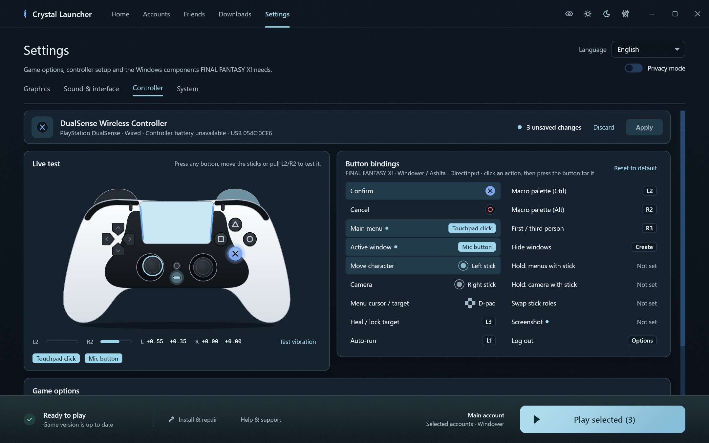

# Crystal Launcher

A Windows launcher for FINAL FANTASY XI. Launch one account or several, manage profiles and keep FFXI and PlayOnline updated.

**[Download the latest release](https://github.com/Offset437/Crystal-Launcher/releases/latest)** · [Report a bug](https://github.com/Offset437/Crystal-Launcher/issues)

Choose **Setup.exe** for installation with Desktop and Start menu shortcuts, or the **portable ZIP** to run without installing. Game files are not included.

## Features

- Vanilla, Windower and Ashita launching, with profiles and optional character auto-login per account.
- PlayOnline friends, status and messages.
- One updater for FFXI and PlayOnline, with file checks, repair, resumable downloads and backups.
- Xbox, PlayStation and ROG Xbox Ally controller setup, plus controller navigation.
- Graphics settings and optional dgVoodoo and ReShade setup.
- Official news, maintenance notices, wiki and FFXIAH searches.
- Privacy mode for hiding account details on screen.

| Xbox controller setup | PS5 controller setup |
| --- | --- |
|  |  |

*Screenshots use sample accounts and controller input. Click an image to view it full size.*

## Setup

Requires 64-bit Windows 10 or later and a retail FFXI account. The US Windows client is the currently tested setup.

1. Open Crystal. It looks for installed FFXI, PlayOnline, Windower and Ashita folders. Use **Browse** if it misses yours.
2. For a fresh installation, get the official Square Enix installer from **Downloads** and install PlayOnline and FFXI. Run **Check files**, then **Update** if needed.
3. Add your accounts under **Accounts**, or use **Import accounts** for saved PlayOnline or Forest accounts. Fill in any missing login details.
4. Choose your launch method and profile, select your accounts, then click **Play selected**.

Saved accounts and settings are kept through launcher updates and reinstalls for the same Windows user. Close games and sign out of PlayOnline sessions before updating or repairing game files.

## Support

[Found a bug or have a suggestion? Open an issue.](https://github.com/Offset437/Crystal-Launcher/issues) Include your Crystal version, launch method, what happened and how to reproduce it. Hide account details and private messages in any screenshots or logs.

For account or billing problems, contact [Square Enix support](https://support.na.square-enix.com/main.php?id=20&la=1).

## License and ownership

Crystal is an independent project, unaffiliated with and not endorsed by Square Enix, Windower or Ashita.

Crystal's code and original SVG interface icons are licensed under [GPL-3.0-only](LICENSE), with no warranty. See [third-party notices](THIRD_PARTY.md) for dependencies and separately sourced artwork. The code license does not cover Square Enix's game, artwork, logos, news images, music or trademarks.

FINAL FANTASY XI © 2002 - 2020 SQUARE ENIX CO., LTD. All Rights Reserved.

FINAL FANTASY is a registered trademark of Square Enix Holdings Co., Ltd. PlayOnline and related Square Enix marks belong to their respective owners.

See the [FINAL FANTASY XI Materials Usage License](https://support.na.square-enix.com/rule.php?id=20&la=1&tag=authc) for Square Enix's conditions.
